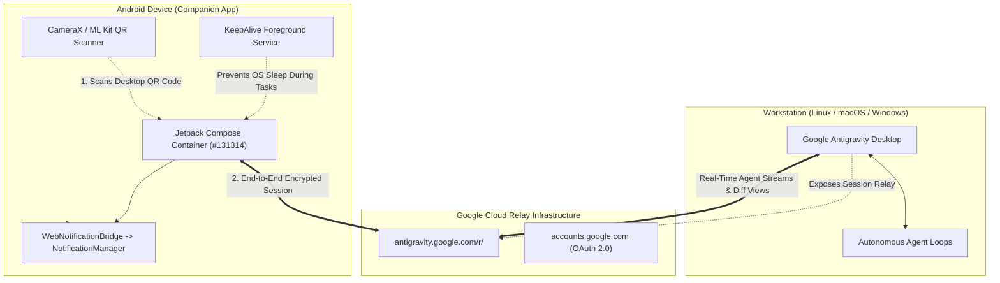

# Antigravity Mobile Companion (Android)

[](https://github.com/ijstt/antigravity-mobile-companion/actions)
[](https://github.com/ijstt/antigravity-mobile-companion/releases)
[](LICENSE)
[](https://developer.android.com)
[](https://kotlinlang.org)
[](SECURITY.md)

An open-source, consumer-grade Android client (Kotlin + Jetpack Compose) for remote interaction with Google Antigravity desktop AI coding assistants.

Designed for developers who need real-time visibility, telemetry, and control over their desktop AI agent sessions from their mobile device, anywhere in the world.

---

## Key Features

- **Immersive Edge-to-Edge Native Shell**: Hardware-accelerated presentation container rendering Google Antigravity Remote edge-to-edge. No browser address bars, lock icons, or duplicate toolbars.
- **Synchronized Dark Theme (`#131314`)**: System status bar and navigation bar seamlessly match the Google Antigravity dark theme palette.
- **Native Android Notifications**: Automatic alerts (sound and vibration) when your AI agent completes a coding task or requires user feedback, even when the app is in the background.
- **Background Keep-Alive Service**: Persistent Android foreground service prevents operating system process suspension during long-running reasoning tasks.
- **CameraX QR Code Pairing**: Instant one-tap pairing by scanning the Google Antigravity Remote QR code displayed on your desktop screen.
- **Session Persistence**: Secure cookie persistence ensures you authenticate once and automatically reconnect across app restarts.
- **File & Photo Attachments**: Integrated `WebChromeClient` file picker contract enables uploading images and documents directly from the Android storage picker into conversations.
- **Voice Input**: Full microphone permission bridging enables speech-to-text dictation in the prompt input field.
- **Zero Telemetry**: No third-party trackers, no advertising SDKs, and zero external analytical logging.

---

## Architecture



---

## Quickstart Guide

### 1. Download & Install
Download the latest pre-compiled `antigravity-companion.apk` from the [GitHub Releases](https://github.com/ijstt/antigravity-mobile-companion/releases) page and install it on your Android device (Android 8.0+).

### 2. Turn On Remote Control on Desktop
In Google Antigravity on your computer:
1. Open **Settings -> Remote Control**.
2. Switch Remote Control **ON**.
3. A pairing QR code will appear on your desktop monitor.

### 3. Scan & Collaborate
1. Launch **Antigravity** on your phone.
2. Tap **«Scan Desktop QR Code»**.
3. Point your camera at your desktop screen.
4. Sign in to your Google Account once.
5. Your active conversations, background tasks, and diffs are instantly ready on your phone.

---

## Security and Privacy Policy

Security and user sovereignty are foundational:
- **Direct Cloud Relay**: All traffic travels directly between your device and Google's official encrypted relay (`antigravity.google.com`).
- **No Third-Party Brokers**: There are no intermediary proxy servers, third-party analytics (no Google Analytics, Firebase, or Sentry), and no external API keys required.
- **On-Device Barcode Processing**: Camera input is analyzed exclusively on-device via Google ML Kit. No frames are recorded, saved, or uploaded.
- **Secure Sandbox**: Authentication session cookies and tokens reside exclusively within Android's sandboxed private storage.
- Detailed disclosure guidelines are documented in [SECURITY.md](SECURITY.md).

---

## Building from Source

### Prerequisites
- Android Studio Koala / Ladybug or newer
- JDK 17
- Android SDK Platform 34

```bash
# Clone the repository
git clone https://github.com/ijstt/antigravity-mobile-companion.git
cd antigravity-mobile-companion

# Compile debug APK
./gradlew assembleDebug

# Install on connected Android device via ADB
adb install -r app/build/outputs/apk/debug/app-debug.apk
```

---

## Contributing

Contributions, bug reports, and suggestions are welcome. Please read [CONTRIBUTING.md](CONTRIBUTING.md) before submitting pull requests.

---

## License

MIT License. Copyright (c) 2026 Vladimir Fedorko.
